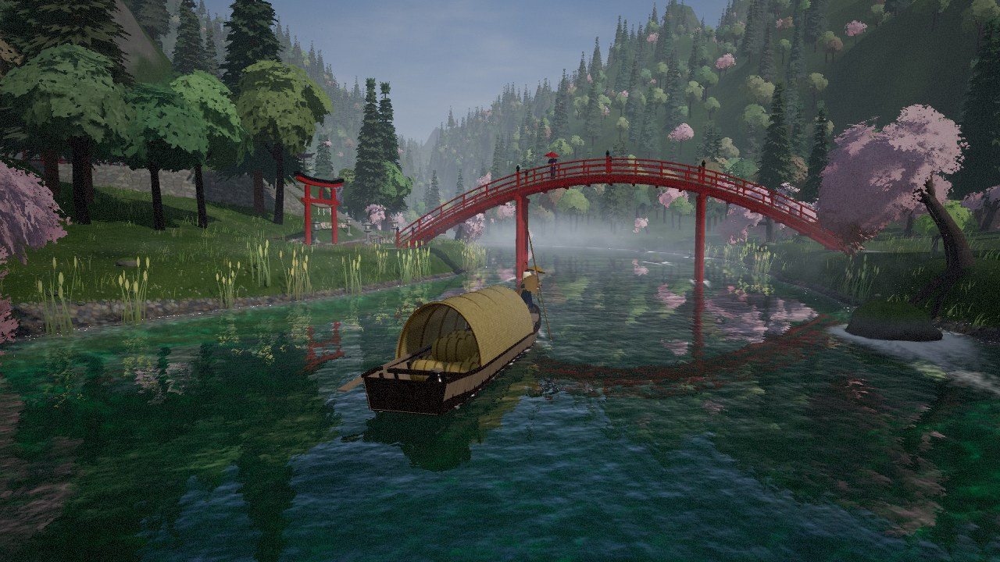
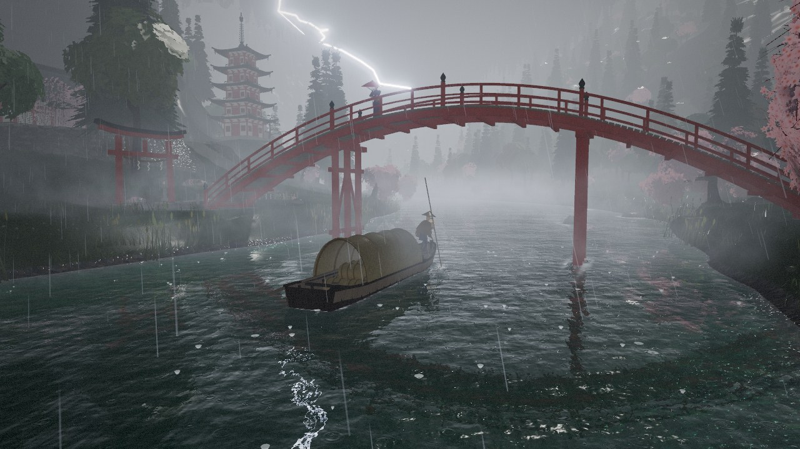
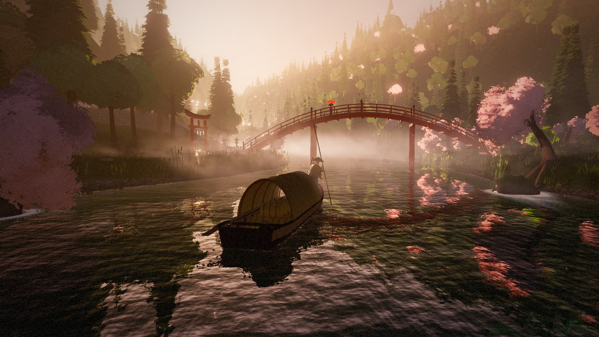
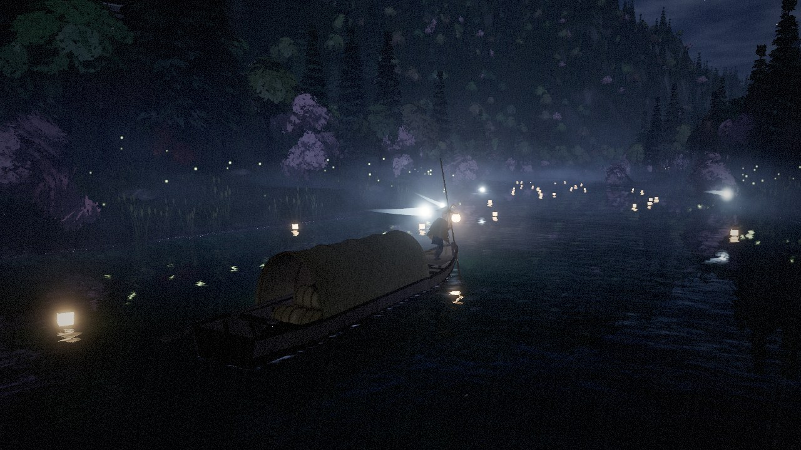

# Sakura River

A real-time 3D scene of a wooden riverboat being poled upstream through a mountain valley in feudal Japan during cherry-blossom season. Everything is procedural and runs in the browser: the terrain, trees, architecture, characters, textures and sound are all generated at load time. The build is a single self-contained HTML file with no network requests.

**Live demo:** https://garfieldhuang.github.io/sakura-river/

| Morning | Storm |
|---|---|
|  |  |
| **Golden hour** | **Night** |
|  |  |

## Run it

Open `index.html` in Chrome or Edge. Nothing needs to be installed. The first load takes about 6–10 seconds while the valley is generated.

## Controls

| Input | Action |
|---|---|
| WASD / arrow keys | Pole and steer the boat yourself. The autopilot takes over again after about 6 seconds without input. |
| Drag | Orbit the camera |
| Scroll | Zoom |
| Hold Space or T | Fast-forward the time of day |
| M | Mute or unmute the sound |

## What's in the scene

- **Valley:** a winding river with a deep channel and pebbled shallows, gravel bars and earthen banks. The valley narrows into a gorge, and far ranges fade into haze.
- **Landmarks:** an arched vermilion bridge on piers standing in the water, a torii gate, stone stairs and dry-stone retaining walls, a main hall with a hip-and-gable roof, a five-storey pagoda, stone lanterns, a wayside shrine, a torii tunnel leading up to a hillside shrine, rope fences with paper streamers, and wind bells.
- **Water:** planar reflections, depth-based refraction and absorption, flow-mapped ripples, foam collars and trails behind rocks and piers, a dynamic boat wake, and rafts of petals in the slack water.
- **Life:** a boatman driven by inverse kinematics who poles against a pole planted on the riverbed, a woman with a red umbrella on the bridge, and a monk sweeping petals. Also falling and drifting petals, birds, herons, fireflies, floating paper lanterns, and spirit wisps.
- **Day-night cycle (about 7 minutes, looping):** dawn, morning, a thunderstorm with rain and lightning, golden hour, sunset, blue hour, moonlit night, and pre-dawn.
- **Sound:** a synthesized soundscape of the river, wind, rain, thunder and bells.

## Build from source

```bash
npm install
npm run build
```

`src/` holds the ES modules, which are bundled with esbuild and inlined into `template.html`. `npm run build` writes `dist/index.html` and copies it to `index.html`, which GitHub Pages serves. Use `npm run build:dev` for an unminified bundle.

| Module | Contents |
|---|---|
| `world.js` | River centreline, (s, d) river coordinates, terrain height, landmark layout, obstacles, flow field |
| `textures.js` | GPU-generated tileable PBR textures and foliage cards |
| `materials.js` | Shader patches for three.js materials: wind, height fog, wetness, translucency, local glow lights |
| `terrain.js`, `veg.js`, `arch.js`, `archkit.js` | Terrain, vegetation and architecture |
| `water.js` | Water shader, reflection camera, wake simulation |
| `boat.js`, `characters.js` | Boat geometry and physics, autopilot, boatman IK, villagers |
| `sky.js`, `cycle.js`, `effects.js` | Sky, day-night cycle, particles, weather |
| `post.js`, `camera.js`, `audio.js`, `main.js` | Render pipeline, chase camera, sound, bootstrap |

## License

MIT. Built on [three.js](https://threejs.org/) (MIT).
